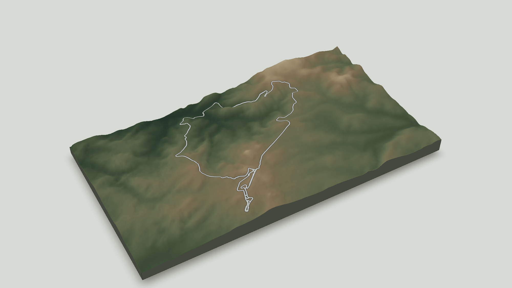

<script>document.body.style.setProperty("--blog-background", "#25382E")</script>

```{r}
#| label: setup
#| include: false

source("blog/_R/post_setup.R")

# Match the shared plot accent to the forest tone used for the post identity.
set_plot_accent_color("#25382E")

install_missing_packages(c(
  "dplyr",
  "elevatr",
  "knitr",
  "osmdata",
  "rayshader",
  "rgl",
  "sf",
  "terra"
))

# Render the WebGL widget without requiring a visible OpenGL window.
options(rgl.useNULL = TRUE, rgl.printRglwidget = FALSE)
rgl::setupKnitr(autoprint = FALSE)
```

The [2D Nürburgring post](../2026-09-10-nurburgring-one-geom-at-a-time/)
draws the circuit as a sequence of `ggplot2` layers. This companion starts with
the same OpenStreetMap geometry, but gives it a terrain surface. The result has
two uses: a small WebGL model to rotate in the browser, and a white-background
image suitable for the post or a card.

We will keep the first version deliberately short: choose the area, cache the
data, shade the elevation and draw the circuit on top. The data download happens
only when the local cache is absent, so camera and style experiments remain fast.

## Data

The racetrack, not an arbitrary bounding box, defines the final frame. A small
margin leaves enough surrounding relief to read the circuit in context.

We use the coordinates listed for the
[Nürburgring](https://de.wikipedia.org/wiki/N%C3%BCrburgring) only as a search
seed. A line's length does not determine its geographic footprint, so we do not
try to infer the circuit's width from its lap distance. Instead, a deliberately
generous 14 km square retrieves the nearby raceway ways. Once OpenStreetMap
returns those geometries, their measured bounds define the frame we actually
plot. The 16:9 ratio and 12% margin are visual choices for this post.

```{r}
#| label: terrain-parameters

library(sf)

# Published longitude/latitude used only to locate the raceway ways.
search_lon <- 6.9476
search_lat <- 50.3356

# This generous window is used only to find the circuit around the search point.
search_width_km <- 14

# The final frame follows the circuit bounds and keeps a landscape proportion.
screen_ratio <- 16 / 9
terrain_margin_pct <- 12

# ETRS89 / UTM zone 32N gives this region coordinates in metres.
search_centre_utm <- sf::st_sfc(
  sf::st_point(c(search_lon, search_lat)),
  crs = 4326
) |>
  sf::st_transform(25832)

search_centre_xy <- sf::st_coordinates(search_centre_utm)[1, ]
search_half_m <- search_width_km * 1000 / 2

# This broad square finds the circuit; it is not the terrain shown in the map.
search_frame_utm <- sf::st_bbox(
  c(
    xmin = search_centre_xy[[1]] - search_half_m,
    ymin = search_centre_xy[[2]] - search_half_m,
    xmax = search_centre_xy[[1]] + search_half_m,
    ymax = search_centre_xy[[2]] + search_half_m
  ),
  crs = sf::st_crs(25832)
) |>
  sf::st_as_sfc()

search_bbox_wgs84 <- search_frame_utm |>
  sf::st_transform(4326) |>
  sf::st_bbox()
```

### Download once, then reuse locally

On its first run this chunk gets the raceway from OpenStreetMap and the elevation
from AWS terrain tiles through `elevatr`. It stores the processed geometry,
elevation matrix and extent in the post's `data/` directory. Commit that RDS with
the post: subsequent renders will read it instead of making either network request.

```{r}
#| label: cache-terrain-data
#| message: false
#| code-fold: true
#| code-summary: "Download and cache the terrain data"

library(dplyr)
library(osmdata)
library(terra)

cache_file <- "blog/posts/2026-09-29-nurburgring-in-3d-with-rayshader/data/nurburgring-3d.rds"
cache_version <- 2L

terrain_data <- if (file.exists(cache_file)) readRDS(cache_file) else NULL
cache_is_current <- !is.null(terrain_data$cache_version) &&
  terrain_data$cache_version == cache_version

if (!cache_is_current) {
  # Query ways only: nodes and relations are not used for the circuit line.
  raceway_query <- osmdata::opq(
    bbox = search_bbox_wgs84,
    osm_types = "way",
    timeout = 180
  ) |>
    osmdata::add_osm_feature(key = "highway", value = "raceway")

  # Overpass is public infrastructure, so retry a small set of global mirrors.
  download_raceways <- function(query) {
    overpass_urls <- c(
      "https://overpass.kumi.systems/api/interpreter",
      "https://overpass-api.de/api/interpreter",
      "https://api.openstreetmap.fr/oapi/interpreter"
    )
    original_url <- osmdata::get_overpass_url()
    on.exit(osmdata::set_overpass_url(original_url), add = TRUE)
    errors <- character()

    for (overpass_url in overpass_urls) {
      osmdata::set_overpass_url(overpass_url)
      message("Requesting raceway data from ", overpass_url, "...")
      response <- tryCatch(
        osmdata::osmdata_sf(query, quiet = TRUE),
        error = function(error) error
      )

      if (!inherits(response, "error")) {
        return(response)
      }

      errors <- c(errors, conditionMessage(response))
    }

    stop(
      "All selected Overpass mirrors failed. Try rendering again later. Last error: ",
      tail(errors, 1)
    )
  }

  track <- download_raceways(raceway_query)$osm_lines |>
    filter(highway == "raceway") |>
    select(osm_id, name, geometry) |>
    sf::st_transform(25832) |>
    sf::st_intersection(search_frame_utm)

  if (nrow(track) == 0) {
    stop("No raceway geometry found around the Nürburgring search area.")
  }

  # Expand the circuit bounds, adjusting the shorter side to the output ratio.
  track_bbox <- sf::st_bbox(track)
  frame_width_m <- (track_bbox[["xmax"]] - track_bbox[["xmin"]]) *
    (1 + terrain_margin_pct / 100)
  frame_height_m <- (track_bbox[["ymax"]] - track_bbox[["ymin"]]) *
    (1 + terrain_margin_pct / 100)

  if (frame_width_m / frame_height_m < screen_ratio) {
    frame_width_m <- frame_height_m * screen_ratio
  } else {
    frame_height_m <- frame_width_m / screen_ratio
  }

  track_centre <- c(
    mean(track_bbox[c("xmin", "xmax")]),
    mean(track_bbox[c("ymin", "ymax")])
  )

  terrain_frame_utm <- sf::st_bbox(
    c(
      xmin = track_centre[[1]] - frame_width_m / 2,
      ymin = track_centre[[2]] - frame_height_m / 2,
      xmax = track_centre[[1]] + frame_width_m / 2,
      ymax = track_centre[[2]] + frame_height_m / 2
    ),
    crs = sf::st_crs(25832)
  ) |>
    sf::st_as_sfc()

  terrain_bbox_wgs84 <- terrain_frame_utm |>
    sf::st_transform(4326) |>
    sf::st_bbox()

  # elevatr needs two corners to identify the terrain tiles covering the frame.
  elev_locations <- data.frame(
    x = c(terrain_bbox_wgs84[["xmin"]], terrain_bbox_wgs84[["xmax"]]),
    y = c(terrain_bbox_wgs84[["ymin"]], terrain_bbox_wgs84[["ymax"]])
  )

  dem <- elevatr::get_elev_raster(
    locations = elev_locations,
    z = 13,
    prj = "EPSG:4326",
    src = "aws",
    verbose = TRUE
  ) |>
    terra::rast() |>
    terra::project("EPSG:25832", method = "bilinear")

  # Cropping after projection makes the saved terrain match the circuit frame.
  dem <- terra::crop(dem, terra::ext(terra::vect(terrain_frame_utm)))
  elevation <- rayshader::raster_to_matrix(dem)
  terrain_extent <- as.vector(terra::ext(dem))
  names(terrain_extent) <- c("xmin", "xmax", "ymin", "ymax")

  dir.create(dirname(cache_file), recursive = TRUE, showWarnings = FALSE)
  saveRDS(
    list(
      cache_version = cache_version,
      track = track,
      elevation = elevation,
      extent = terrain_extent,
      resolution_m = mean(terra::res(dem))
    ),
    cache_file
  )

  terrain_data <- readRDS(cache_file)
}

track <- terrain_data$track
elevation <- terrain_data$elevation
terrain_extent <- terrain_data$extent
resolution_m <- terrain_data$resolution_m

# The overlay generator expects individual LINESTRING geometries.
track_paths <- track |>
  sf::st_cast("LINESTRING", warn = FALSE)
```

### The track

Let's start with `track`. It is an `sf` data frame: two ordinary columns,
`osm_id` and `name`, plus a `geometry` column with the lines. Printing it tells
us how many features we have, their geometry type, bounding box and coordinate
reference system.

```{r}
#| label: inspect-track-object

dplyr::glimpse(track)
utils::head(track, 6)

# Measure the footprint rather than adding the lengths of winding track segments.
track_bbox <- sf::st_bbox(track)
c(
  west_to_east_km = round(
    (track_bbox[["xmax"]] - track_bbox[["xmin"]]) / 1000,
    2
  ),
  south_to_north_km = round(
    (track_bbox[["ymax"]] - track_bbox[["ymin"]]) / 1000,
    2
  )
)
```

So this is not one continuous circuit line. OpenStreetMap stores the circuit,
its named sections and connecting roads as separate ways. They are already
projected to EPSG:25832, which means their coordinates are measured in metres.
Together the returned raceway features occupy a little more than 6 km in each
direction. The 14 km discovery square was deliberately generous; from this
point onward, these measured bounds replace it and define the terrain frame.

Before doing anything in 3D, let's plot those lines. Nothing fancy yet: this is
only a quick check that we downloaded the geometry we expected.

```{r}
#| label: plot-track-input
#| fig-alt: "A diagnostic line plot of the OpenStreetMap raceway features around the Nürburgring."

plot(sf::st_geometry(track), axes = TRUE, asp = 1)
```

### The elevation matrix

The other main object is `elevation`. This time we do not have a data frame or
an `sf` object, but a numeric matrix created by
`rayshader::raster_to_matrix()`. Every cell contains one terrain height in
metres. Let's look at its structure and range.

```{r}
#| label: inspect-elevation-object

str(elevation)

c(
  minimum_m = round(min(elevation, na.rm = TRUE)),
  maximum_m = round(max(elevation, na.rm = TRUE)),
  resolution_m = round(resolution_m, 1)
)
```

A matrix is already enough to get a first look at the terrain. We use `image()`
instead of `plot()`: the latter would interpret the first two matrix columns as
paired coordinates. Reversing the columns restores the north-up orientation of
the original raster.

```{r}
#| label: plot-elevation-input
#| fig-alt: "A diagnostic colour image of the elevation matrix around the Nürburgring, before terrain shading."

image(
  elevation[, ncol(elevation):1],
  col = grDevices::terrain.colors(64),
  axes = FALSE,
  asp = 1,
  useRaster = TRUE
)
```

### Where is the matrix?

There is one piece missing. A matrix has rows, columns and values, but it does
not know where it is on a map. `terrain_extent` is a named numeric vector with
its projected limits: `xmin`, `xmax`, `ymin` and `ymax`. `resolution_m` is simply
the average ground size of one cell. Together they tell `rayshader` where the
`sf` lines belong on the elevation matrix.

```{r}
#| label: inspect-terrain-metadata

terrain_extent
resolution_m
```

The initial request downloads only the [AWS Terrain Tiles](https://registry.opendata.aws/terrain-tiles/)
that cover this small frame, through [`elevatr`](https://github.com/USEPA/elevatr),
not a global elevation dataset. The RDS is then a processed cache rather than a
copy of every raw response: it keeps `track`, `elevation`, `terrain_extent` and
`resolution_m`. A cache fixed at the final 400-cell limit would be smaller, but
keeping the full matrix lets us change that resolution without downloading the
terrain again. The next step creates a lighter working surface for both the
WebGL model and the rendered images.

## Build and explore the terrain

The full matrix stays in the cache, but the 3D scene does not need every cell.
Rather than preparing the complete texture in one long pipeline, let's build it
one layer at a time and look at each result.

### A lighter height matrix

First we sample a smaller working matrix. `interactive_step` tells us how many
cells we skip in each direction. This makes the scene faster, but also increases
the ground distance represented by every remaining cell.

```{r}
#| label: reduce-terrain-matrix

library(rayshader)

# Limit the working surface while keeping the full elevation matrix in the cache.
interactive_max_dim <- 600

# Downsample the working mesh, retaining the full matrix in the local cache.
interactive_step <- max(1L, ceiling(max(dim(elevation)) / interactive_max_dim))
interactive_rows <- seq.int(1L, nrow(elevation), by = interactive_step)
interactive_cols <- seq.int(1L, ncol(elevation), by = interactive_step)
elevation_interactive <- elevation[
  interactive_rows,
  interactive_cols,
  drop = FALSE
]

interactive_resolution_m <- resolution_m * interactive_step

# A smaller zscale exaggerates the vertical relief in rayshader.
vertical_exaggeration <- 2
zscale <- interactive_resolution_m / vertical_exaggeration

c(
  original_grid = paste(dim(elevation), collapse = " × "),
  working_grid = paste(dim(elevation_interactive), collapse = " × "),
  keep_every_nth_cell = interactive_step,
  working_resolution_m = round(interactive_resolution_m, 1)
)
```

`zscale` compares that horizontal cell spacing with the vertical values. Dividing
it by two exaggerates the relief: this is a visual choice rather than a change
to the elevation data.

### Give the terrain an organic palette

`height_shade()` turns the numeric matrix into an RGB image. Dark greens describe
the lower elevations, while olive, earth and mineral tones appear progressively
higher. This gives the surface an organic reading without downloading satellite
imagery or pretending that the colours describe actual land cover.

```{r}
#| label: colour-terrain-heights
#| fig-alt: "An organic green and earth-coloured texture following the slopes around the Nürburgring."

# These colours suggest forest, earth and exposed terrain without claiming to be
# a satellite or vegetation map.
organic_palette <- grDevices::colorRampPalette(c(
  "#25382E",
  "#40513A",
  "#687052",
  "#8A795B",
  "#C7BA96"
))(256)

terrain_texture <- elevation_interactive |>
  rayshader::height_shade(texture = organic_palette)

rayshader::plot_map(terrain_texture)
```

### Add directional light

`ray_shade()` follows the light across the elevation matrix, so a ridge can cast
a shadow on the terrain behind it. The light comes from 315° and sits 35° above
the horizon. We keep the darkening subtle: the goal is to reveal the relief, not
turn every valley black.

```{r}
#| label: shade-terrain-surface
#| fig-alt: "A green and earth-coloured terrain texture with soft projected shadows revealing ridges and valleys."

terrain_shadow <- rayshader::ray_shade(
  elevation_interactive,
  zscale = zscale,
  sunangle = 315,
  sunaltitude = 35
)

# Values closer to one retain more of the original palette.
terrain_texture <- terrain_texture |>
  rayshader::add_shadow(terrain_shadow, max_darken = 0.70)

rayshader::plot_map(terrain_texture)
```

### Draw the track on the texture

`generate_line_overlay()` translates the projected `sf` lines into an RGBA
image aligned with the elevation matrix. RGBA means red, green, blue and alpha,
the transparency channel. It is therefore an image array, not a vector of values.
Calling base `plot()` on it flattens the channels and produces a misleading
index plot; [`plot_map()`](https://www.rayshader.com/reference/plot_map.html)
understands the image structure.

We first draw a wide dark line. `resolution_multiply = 2` creates the overlay at
twice the working resolution so its edges remain crisp.

```{r}
#| label: create-track-casing-overlay

track_casing_overlay <- rayshader::generate_line_overlay(
  track_paths,
  extent = terrain_extent,
  heightmap = elevation_interactive,
  resolution_multiply = 2,
  color = "#202724",
  linewidth = 7
)

list(
  class = class(track_casing_overlay),
  dimensions = dim(track_casing_overlay)
)
```

Add that array to the shaded terrain and use `plot_map()` to inspect the actual
image composition.

```{r}
#| label: add-track-casing-overlay
#| fig-alt: "The shaded terrain texture with a broad dark Nürburgring line added as an overlay."

terrain_with_casing <- terrain_texture |>
  rayshader::add_overlay(
    track_casing_overlay,
    rescale_original = TRUE
  )

rayshader::plot_map(terrain_with_casing)
```

The second overlay is narrower and concrete grey. Placing it over the dark line
creates a simple two-stroke track that remains visible on both light and shaded
slopes without looking painted white.

```{r}
#| label: add-track-line-overlay
#| fig-alt: "The completed terrain texture with a narrow light-grey circuit inside its dark casing."

track_line_overlay <- rayshader::generate_line_overlay(
  track_paths,
  extent = terrain_extent,
  heightmap = elevation_interactive,
  resolution_multiply = 2,
  color = "#C4C6C2",
  linewidth = 4
)

terrain_texture <- terrain_with_casing |>
  rayshader::add_overlay(track_line_overlay, rescale_original = TRUE)

rayshader::plot_map(terrain_texture)
```

### Explore the model

The track is already part of `terrain_texture`, so `plot_3d()` only needs to
wrap that finished image over the elevation matrix. Drawing the paths again in
3D would duplicate the line and expose the joins between the original
OpenStreetMap ways.

The 2D checks above remain north-up. For the editorial 3D view, we rotate the
camera 30° so the terrain follows the diagonal of the wide frame and uses more
of the available space. This changes only the presentation: `phi` sets the
camera elevation and `fov` supplies the perspective.

The [`theta`, `phi`, `zoom` and `fov`](https://www.rayshader.com/reference/plot_3d.html)
arguments control the viewpoint; they are not properties of the Nürburgring.
We choose them here and reuse the same camera for the interactive and static
versions.

```{r}
#| label: choose-camera-view

# A small clockwise rotation lets the rectangular terrain fill the wide frame.
camera_theta <- 330
camera_phi <- 42
camera_zoom <- 0.65
camera_fov <- 35
```

```{r}
#| label: render-interactive-model
#| column: page
#| code-fold: true
#| code-summary: "Build the interactive scene"
#| fig-alt: "Interactive oblique 3D terrain around the Nürburgring, with a light-grey circuit traced over an organic green and earth-coloured surface."

# This helper recreates the same terrain for the widget and both image exports.
draw_terrain_scene <- function() {
  terrain_texture |>
    rayshader::plot_3d(
      elevation_interactive,
      zscale = zscale,
      theta = camera_theta,
      phi = camera_phi,
      zoom = camera_zoom,
      fov = camera_fov,
      windowsize = c(1200, 675),
      background = "#D7D9D5",
      solid = TRUE,
      solidcolor = "#45483F",
      solidlinecolor = "#34372F",
      shadow = TRUE,
      shadowcolor = "#77786F"
    )
}

draw_terrain_scene()
rgl::rglwidget(width = 1200, height = 675)
```

Drag to rotate the terrain and use the scroll wheel to zoom. Once a view works,
copy its `theta`, `phi`, `zoom` and `fov` values into the parameters above before
rendering a new static image.

```{r}
#| label: save-editorial-images
#| include: false

images_dir <- "blog/posts/2026-09-29-nurburgring-in-3d-with-rayshader/images"
dir.create(images_dir, recursive = TRUE, showWarnings = FALSE)

# The track is already part of terrain_texture.
draw_terrain_scene()
rayshader::render_snapshot(
  filename = file.path(images_dir, "nurburgring-3d.png"),
  width = 2000,
  height = 1125,
  software_render = TRUE,
  clear = TRUE
)

# The same uncluttered composition also works at card size.
file.copy(
  file.path(images_dir, "nurburgring-3d.png"),
  file.path(images_dir, "preview.png"),
  overwrite = TRUE
)
```

::: {.column-page}

:::

The greens and earth tones are an editorial treatment derived from elevation,
not observed vegetation. Adding real forest, buildings or water would require a
separate land-cover source rather than more 3D rendering.

## References

- [Wikipedia contributors, *Nürburgring*](https://de.wikipedia.org/wiki/N%C3%BCrburgring) — approximate coordinates used to seed the OpenStreetMap search.
- [OpenStreetMap contributors](https://www.openstreetmap.org/copyright) — circuit geometry, licensed under the ODbL.
- [Mapzen, *Terrain Tiles*](https://registry.opendata.aws/terrain-tiles/) — elevation data hosted by the Registry of Open Data on AWS.
- [US Environmental Protection Agency, `elevatr`](https://github.com/USEPA/elevatr) — R interface used to download the terrain tiles.
- [Tyler Morgan-Wall, `plot_map()` documentation](https://www.rayshader.com/reference/plot_map.html) — display matrices and RGB/RGBA arrays during the texture-building steps.
- [Tyler Morgan-Wall, `height_shade()` documentation](https://www.rayshader.com/reference/height_shade.html) — map elevation to the organic colour palette.
- [Tyler Morgan-Wall, `ray_shade()` documentation](https://www.rayshader.com/reference/ray_shade.html) — calculate soft shadows cast across the terrain.
- [Tyler Morgan-Wall, `generate_line_overlay()` documentation](https://www.rayshader.com/reference/generate_line_overlay.html) — align projected line geometries with a height map.
- [Tyler Morgan-Wall, rayshader documentation](https://www.rayshader.com/reference/plot_3d.html) — terrain scene, camera and static render workflow.
